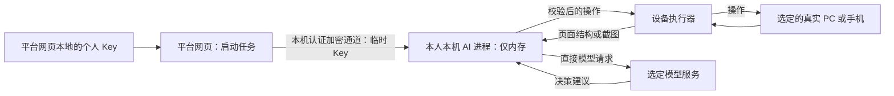

# AI 编排位置、真机与凭据路径

2026-10-30 更新。当前只接入自管真实 PC、安卓和 iPhone，第三方/云真机接入暂缓。取消 AI 定时相关功能；普通固定步骤定时回放、飞书周期同步及文本差异检查保留。团队模型可选，配置后 Key 后端加密保存，页面测试由授权设备主机的独立 AI 进程临时使用并直连模型。个人 Key 仅网页本地持久化，每次启动任务时交给本人本机临时内存使用，结束清除，不上传后端或写入执行器磁盘。

以上为最新确认的范围与凭据边界，替代此前第三方设备和 AI 定时执行的设计；未确认的交互建议单独列于文末。开发仍按 D06、D22～D25 推进，X03 标记暂缓且不作为当前交付依赖；D02 不包含模型调用、凭据交接或真机驱动实现。

## 模型配置是可选能力

用户补充确认团队模型不一定存在。平台支持无模型、仅个人模型、仅团队模型及两者都有的配置；团队 Key 可以保存，不代表部署时必须提供。录制、编辑、固定步骤回放、录像、普通报告及固定步骤定时运行不要求模型凭据。

AI 任务先选择当前可用且获授权的模型来源，再按既定路径执行。团队模型已配置、获授权且被选用时，由授权自管设备主机运行页面 AI；个人模式始终由本人本机临时使用 Key。配置不存在、权限不足、调用失败或额度不足时，不自动切换模型或计费账号。没有模型时仅相应 AI 操作未就绪，不能阻塞整个平台或把未完成的 AI 验证计为通过。

“只使用个人模型”应能覆盖需求生成、探索、修改和失败分析等 AI 功能；其可用性依赖本人本机 AI 进程与当前任务凭据，而不依赖团队 Key。各功能的交互与后台触发细节按文末待讨论项完善。

## 设备与 AI 职责分别确定

| 角色        | 职责及位置                                                                                                                                             |
| ----------- | ------------------------------------------------------------------------------------------------------------------------------------------------------ |
| 平台网页    | 需求输入、配置、用例编辑、实时查看和接管；保存个人 Key，启动个人 AI 任务时读取并临时交接                                                               |
| NestJS      | 项目、任务、设备调度、权限、团队凭据、额度、报告；不接收个人 Key                                                                                       |
| AI 编排进程 | 收集页面信息、请求模型、校验建议及调用受限工具；个人模式在本人本机，团队页面 AI 在授权自管设备主机；纯文档分析：个人在本人本机，团队在后端独立 AI 进程 |
| 设备执行器  | 在选中的真实 PC 上控制浏览器，或在连接手机的主机上控制真实安卓/iPhone；不因 AI 位置变化而替换测试设备                                                  |
| 模型服务    | 使用供应商 API 时，模型推理仍发生在供应商服务；自部署模型按其实际部署位置运行                                                                          |

PC 使用 Playwright 控制选定测试电脑上的浏览器；安卓 Chrome 通过设备主机上的 Appium 控制；iPhone Safari 首版通过 Mac/Xcode/WDA/Appium 控制。执行器可以以桌面 App 或主机后台进程运行。“服务器承载 AI”不意味着在管理服务器上另开浏览器代替指定真机。

## 个人模型：网页保存，本机临时调用

以本人 Mac 连接 iPhone 为例：

1. 用户在网页选择 iPhone、测试环境和个人模型，启动任务。
2. 网页从本地凭据存储读取 Key，通过已配对、已认证且加密的本机通道交给隔离的 AI 进程。绑定本人、任务、供应商和有效期；普通任务接口、队列和日志只携带配置引用。
3. Mac 上的设备执行器读取 iPhone Safari 的页面结构或必要截图，交给本机 AI 进程。
4. AI 进程直接请求选定模型，校验完整响应及动作权限，再让设备执行器操作同一台 iPhone；根据新的页面状态继续循环。
5. 任务结束、取消或授权到期后停止使用 Key、释放内存引用并结束该凭据会话；执行器重启后必须重新从网页交接，不能从磁盘恢复 Key。

个人 Key 不保存到执行器配置、操作系统凭据库、环境变量、任务快照、业务脚本或产物中；应用不将其写入日志或崩溃转储。网页到执行器的认证、来源限制、加密和浏览器本地连接权限需在 D06/D22 验证；连接失败时明确提示，不退回经平台后端转发 Key。

网页本地持久化不等于明文 `localStorage` 已足够安全。具体加密、解锁、删除与账号切换隔离在 D22 验证；同源恶意脚本仍是需要处理的风险，不承诺仅依靠浏览器存储即可消除。网页删除已保存 Key 与撤销正在运行的凭据会话分别处理，并提供明确的停止入口。

## 团队模型与远程自管设备

| 场景                                | 已确认的 AI 路径                                               | 在线与传输条件                                                                  |
| ----------------------------------- | -------------------------------------------------------------- | ------------------------------------------------------------------------------- |
| 个人 Key + 本机 PC 或本机连接的手机 | 本机 AI 直接调用模型                                           | 任务已接收 Key 后可关闭网页；本机及设备必须在线，模型请求的截图无需经过平台后端 |
| 个人 Key + 远程共享自管真机         | 远程自管主机将页面信息送到本人本机，本机 AI 调用模型并返回操作 | 本人本机与设备主机均须在线；有额外画面传输，个人 Key 不交给远端或共享主机       |
| 团队 Key + 自管真机                 | 在设备执行主机的独立 AI 进程中临时使用团队凭据，直接请求模型   | 自管主机与设备须在线；截图无需先经平台转发，团队任务仍受服务端权限及额度控制    |

团队 Key 后端加密保存，加密密钥与数据库分别管理。自管设备的执行主机须完成平台绑定和团队授权，设备归属及凭据接收权限由服务端校验，不能凭客户端自报“自管”获得 Key。通过认证加密通道向该主机的隔离 AI 进程提供凭据，仅在任务期间内存使用，结束、取消或授权到期后清除；不写入主机磁盘，不暴露给普通 Runner、被测页面或业务脚本。

自管主机直连每次模型调用前向平台申请项目、任务和模型权限授权及额度预占，调用后上报用量；授权不可用时暂停新调用，不能仅凭事后统计实现上限。当前不实现第三方设备对应的服务端 AI 操作路径。

“临时使用”描述的是应用内的凭据生命周期，不会使供应商长期 Key 自动到期。若供应商支持合适的短期、限权凭据，优先使用并逐厂商验证；否则仅向已授权的自管主机提供长期 Key，不承诺清除本机内存即可撤销被复制的 Key。平台撤销授权阻止后续合法调用，供应商 Key 的失效仍依赖其轮换或撤销机制。

远程自管设备仍可被平台管理。个人 Key 仅由本人本机临时使用，即使设备不在身边，也不能上传平台后端或交给远端主机；画面先回到本人本机。画面优先走认证直连，必要时经授权中转，流向可查，中转不包含个人 Key。第三方设备、供应商适配和对应画面链路当前均不实施。

## 减少等待和模型调用

- 优先使用驱动实际支持的 DOM、可访问结构和必要文本；需要视觉判断时再传截图。对截图适度裁剪或降采样，保留判断所需上下文，无法识别时重新采集更完整的画面。
- 简单表单可生成少量连续动作，由执行器逐步验证前置条件和权限后执行；导航、提交或状态变化后重新观察。不给模型一次生成的长流程无条件执行，不执行尚未完成校验的流式工具参数。
- 将稳定流程保存为统一步骤和断言，日常回归直接回放，仅在生成、探索或修复时调用 AI。减少重复调用不意味着自动弱化断言或把失败改为通过。
- 页面信息携带任务、设备、环境和观察版本；只复用仍然有效的信息，缓存失效则重新采集。实时查看、AI 与取证可复用同一次采集，避免各自重复截图。
- 报告、截图和视频继续按已确认策略异步归档，不把归档完成作为每一步 AI 决策的前置等待。上传失败单独记录；模型直连不等于取消报告上传，也不等于整个任务只有一次数据上传。

## 生命周期与权限

关闭网页后，已获临时 Key 的当前个人 AI 任务可在授权有效期和任务预算内继续；本机休眠、退出或凭据失效后暂停/终止并记录原因，不无限保留 Key 等待重连。新任务或重新授权的恢复须再次由网页交接 Key；网页关闭或挂起且尚未交接时，后端和执行器不能代为读取。已发起任务中的 AI 决策循环及已授权修订属于同次运行，仍按已有预算与次数限制执行。

普通固定步骤回放及其定时运行不依赖模型 Key，关闭网页后的运行只要求对应任务服务与设备执行器在线。个人模型处理需求文档或历史报告仍沿用本机凭据路径，不将个人 Key 交给后端；这类纯分析任务不要求占用真机。团队模型只有存在且被选用时，才可由授权服务进程处理纯分析任务。飞书同步、文本提取和确定性的版本差异检测可独立执行；语义分析、生成或修复等模型调用则单独检查所选模型与凭据就绪状态。

个人与团队模型都遵守目标环境的动作规则。每次工具调用校验任务、设备租约、环境及操作权限；权限检查必须落在可信服务和设备执行边界，不能只依靠模型提示词。模型不能直接执行任意系统命令；普通 Runner 和业务脚本不能读取 AI 进程的模型凭据。供应商、路由和计费账号不自动切换。

## 普通定时与 AI 的范围

- D20 的普通定时测试、Cron、项目时区和重叠策略继续保留，仅运行已保存的固定步骤及既定断言，不要求模型 Key。AI 生成后已保存为固定步骤、运行时不再调用模型的用例同样可以定时回放。
- 个人和团队模式均不提供 AI 定时计划；不通过普通定时任务或文档周期检查自动触发 AI 生成、探索、分析、修复。创建定时任务时须识别依赖模型的配置，明确提示不支持，不能跳过必需验证后计为通过。
- 飞书原有周期更新检查、文本提取及确定性的版本差异继续执行；需要模型的语义分析、用例生成或修改由用户另行发起。周期刷新不自动消费个人或团队模型额度。
- 普通定时回放失败后保存原始结果和证据；用户可随后按需发起 AI 分析或修复，不能借失败回调把它变为定时 AI。正常的固定步骤重试及人工发起的 AI 任务内已授权修订仍按现有规则执行。

## 文档处理位置（2026-10-30 已确认）

- 飞书文档获取、Markdown 解析、内容及版本保存、确定性文本差异比较由 NestJS 后端处理，不调用模型。
- 使用个人模型理解需求、提取场景和生成草稿时，平台将文档内容提供给本人本机的隔离 AI 进程，由该进程直接请求所选模型，再将结果返回平台。个人 Key 仅网页本地持久化、本机临时内存使用，不交给后端。
- 使用团队模型执行上述文档分析时，由后端独立 AI 进程调用已配置且选定的团队模型，不要求测试设备在线；仍校验权限、额度与任务预算，团队模型不是必需配置。
- 纯文档分析不分配真机。需要实际页面观察或试跑时再申请设备，沿用个人 AI 在本人本机、团队页面 AI 在授权设备主机的路径。
- 使用云模型时，推理仍发生在模型供应商服务；上述位置描述的是 AI 请求编排进程。文档同步与 AI 分析分开，周期同步不自动触发模型调用。

本节确认执行位置，不表示 AI 功能已实现，也不扩展为 AI 定时任务。

## 本轮待讨论项

以下为评估建议，尚未作为用户确认的产品行为；个人 Key 保存位置、临时使用范围及团队模型可选的约束不再变更。

- 模型选择界面：建议在提交前明确模型来源和计费归属，仅列出可用配置；无模型时提示配置入口。不能以团队配置缺失为由自动启用个人 Key。
- 历史报告 AI：建议个人模式使用本人本机 AI 进程，团队模式使用已配置的服务端模型，无需分配真机；具体交互仍待讨论。文档分析执行位置已确认，见上节。
- 固定回放后按需发起 AI 分析或修复：建议单独记录分析任务的凭据等待或未执行，不改变原始测试结论；缺少凭据的必需 AI 验证不能跳过后计为通过。
- 个人模型使用远程自管设备：沿用 Key 留在本人本机的边界，界面显示本人本机在线依赖和实际画面路径。
- 用量与费用展示：团队月度额度只约束团队账号用量；个人任务仍受环境规则和任务预算约束。个人用量及估算费用的可见范围与预算设置需补充，不将个人支出计入团队模型额度。

上轮远程 PC 人工接管、排队交接时点、自动换机和主机授权配置的建议仍待 review；团队凭据接收授权仅在配置并选用团队模型时适用，不作为个人 AI 或普通设备接入的前置条件。

## 验收安排

- D06：一个真实模型完成真机页面观察、步骤生成和试跑，验证网页向本人本机临时交接 Key 的可行性；三端沿用 D03～D05 的真实设备验证，不以云浏览器替代。
- D22：覆盖无模型、仅个人、仅团队及两者都有；验证个人凭据存储/交接、个人直连、团队自管主机直连及远程自管设备的画面路径。检查设备授权、调用前额度、隔离和脱敏，以及关闭网页、进程退出、取消、授权到期和重新授权；不以缺少团队模型为由自动切换账号。
- D24/D25：验证按需生成、探索、动作规则、人工暂停和恢复；比较固定样例的截图量、模型调用数及耗时。联合 D20/D23 验证普通定时回放及飞书周期检查不调用模型，不提供 AI 定时入口，不以跳过必需验证产生通过结果。

团队自管主机直连属于 D22 正式范围；X03 暂缓且不排期，恢复第三方接入前重新确认。已确认边界与待讨论建议分别列于上文，实际模型、凭据通道和手机测试尚未完成。
