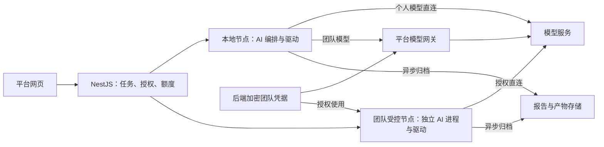

# AI 编排位置与模型调用路径

2026-10-29 用户确认。此决定更新 AI 相关设计，实际开发仍按 D06、D22～D25 推进；D02 不包含模型调用实现。

## 默认职责

AI 编排优先跟随浏览器或手机执行节点，复用 `packages/ai-agent` 的模型适配、决策循环和受限工具协议。平台网页负责需求输入、编辑、查看进度及人工接管；NestJS 负责项目、任务、权限、团队凭据、额度和报告。动作由对应驱动执行。

“AI 在执行端”指截图收集、模型请求和工具编排所在位置；使用供应商 API 时，大模型推理仍在模型服务端。管理网页无需保持打开，实际 AI 进程及设备执行节点必须在线。

## 按凭据和执行位置选择路径

| 场景                          | AI 编排与模型请求                              | 截图路径及凭据边界                                                                                   |
| ----------------------------- | ---------------------------------------------- | ---------------------------------------------------------------------------------------------------- |
| 本地执行 + 个人 Key           | 本地执行器的 AI 模块直接请求模型               | 截图直接从本机发给模型；个人 Key 不提交平台，默认内存，可选系统凭据库                                |
| 团队受控服务器执行 + 团队 Key | 同节点或邻近的独立 AI 进程，凭授权直接请求模型 | 截图无需先经管理 API 转发；团队 Key 后端加密保存，仅授权 AI 进程可读取，不注入普通 Runner 或脚本环境 |
| 个人电脑执行 + 团队 Key       | 本地编排，通过平台模型网关发起调用             | 截图仍经过网关转发；团队主 Key 不下发个人电脑。网关验证项目、任务、模型权限及额度                    |
| 远端设备执行 + 个人 Key       | AI 编排仍在持有个人 Key 的个人执行端           | 远端画面须先送到个人端再给模型，此路径仍有额外传输；不因设备在远端而上传个人 Key                     |

供应商若提供适用的短期、限权凭据，可在单独验证后优化团队模型直连路径；首版不假定各厂商都支持，也不将团队主 Key 放进网页或普通执行器。

图中的本地直连针对本地采集画面的个人模型任务；远端设备 + 个人 Key 的额外画面传输按上表处理。

## 维护约束

- 截图以执行节点采集为源头，不要求先传回管理网页。团队模型网关路径明确保留转发成本，不能宣称所有任务都只上传一次。
- 报告、截图、视频仍按已确认策略异步上传归档；缩短模型调用路径不等于取消产物上传或默认保留。归档不放在每一步 AI 决策的前置等待中，上传失败须单独记录。
- 团队模型直连与网关统一使用服务端权限和额度授权。直连 AI 进程调用前申请授权及额度预占，调用后上报用量，不能仅事后统计来实现上限。具体并发预算与取消回收在 D22 验证。
- 个人与团队模型都遵守目标环境动作规则。密钥不出现在任务快照、工具参数、业务脚本、日志或产物中；供应商、路由与计费账号不自动切换。
- 管理网页不承担默认模型调用。浏览器直连受供应商 CORS、密钥隔离和网页生命周期限制；此决定未新增网页直连模式的交付要求。
- 纯文档解析可在授权的服务进程处理；需要观察页面的生成、修复与探索采用上述执行节点路径。文档或画面发给哪个供应商仍受所选模型及任务授权约束。

## 验收安排

D06 验证一个真实模型与执行节点的最小页面观察、步骤生成和试跑；D22 验证个人直连、受控团队节点直连及个人节点经团队网关三条调用路径，检查凭据、截图流向、授权和额度。D24/D25 验证生成、探索、暂停及恢复。远端设备与个人模型的组合需记录画面转发和在线条件，不能以本地测试替代。
