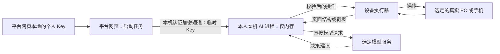

# AI 编排位置、真机与凭据路径

2026-10-29 更新。用户确认：平台管理真实 PC、安卓和 iPhone；团队 Key 可以由后端保存；个人 Key 只在平台网页本地持久化，每次启动任务时读取，允许临时交给本人本机执行器在内存中使用，任务结束清除，不上传平台后端、不写入执行器磁盘。

以下为据此调整的实施方案，供本次 review。实际开发仍按 D06、D22～D25 推进；D02 不包含模型调用、凭据交接或真机驱动实现。

## 设备与 AI 职责分别确定

| 角色        | 职责及位置                                                                                             |
| ----------- | ------------------------------------------------------------------------------------------------------ |
| 平台网页    | 需求输入、配置、用例编辑、实时查看和接管；保存个人 Key，启动个人 AI 任务时读取并临时交接               |
| NestJS      | 项目、任务、设备调度、权限、团队凭据、额度、报告；不接收个人 Key                                       |
| AI 编排进程 | 收集页面信息、请求模型、校验模型建议、调用受限工具；个人模式在本人本机，团队模式使用服务端受控 AI 进程 |
| 设备执行器  | 在选中的真实 PC 上控制浏览器，或在连接手机的主机上控制真实安卓/iPhone；不因 AI 位置变化而替换测试设备  |
| 模型服务    | 使用供应商 API 时，模型推理仍发生在供应商服务；自部署模型按其实际部署位置运行                          |

PC 使用 Playwright 控制选定测试电脑上的浏览器；安卓 Chrome 通过设备主机上的 Appium 控制；iPhone Safari 首版通过 Mac/Xcode/WDA/Appium 控制。执行器可以以桌面 App 或主机后台进程运行。“服务器承载 AI”不意味着在管理服务器上另开浏览器代替指定真机。

## 个人模型：网页保存，本机临时调用

以本人 Mac 连接 iPhone 为例：

1. 用户在网页选择 iPhone、测试环境和个人模型，启动任务。
2. 网页从本地凭据存储读取 Key，通过已配对、已认证且加密的本机通道交给隔离的 AI 进程。绑定本人、任务、供应商和有效期；普通任务接口、队列和日志只携带配置引用。
3. Mac 上的设备执行器读取 iPhone Safari 的页面结构或必要截图，交给本机 AI 进程。
4. AI 进程直接请求选定模型，校验完整响应及动作权限，再让设备执行器操作同一台 iPhone；根据新的页面状态继续循环。
5. 任务结束、取消或授权到期后停止使用 Key、释放内存引用并结束该凭据会话；执行器重启后必须重新从网页交接，不能从磁盘恢复 Key。

个人 Key 不保存到执行器配置、操作系统凭据库、环境变量、任务快照、业务脚本或产物中；应用不将其写入日志或崩溃转储。网页到执行器的认证、来源限制、加密和浏览器本地连接权限需在 D06/D22 验证；连接失败时明确提示，不退回经平台后端转发 Key。

网页本地持久化不等于明文 `localStorage` 已足够安全。具体加密、解锁、删除与账号切换隔离在 D22 验证；同源恶意脚本仍是需要处理的风险，不承诺仅依靠浏览器存储即可消除。网页删除已保存 Key 与撤销正在运行的凭据会话分别处理，并提供明确的停止入口。

## 团队模型与远程设备

| 场景                                  | 建议的 AI 路径                                                 | 在线与传输条件                                                                         |
| ------------------------------------- | -------------------------------------------------------------- | -------------------------------------------------------------------------------------- |
| 个人 Key + 本机 PC 或本机连接的手机   | 本机 AI 直接调用模型                                           | 任务已接收 Key 后可关闭网页；本机及设备必须在线，模型请求的截图无需经过平台后端        |
| 个人 Key + 远程共享真机               | 远程设备主机把页面信息送到本人本机，本机 AI 调用模型并返回操作 | 本人本机及远程设备主机都要在线；存在额外画面传输，不把 Key 交给共享或远程设备主机      |
| 团队 Key + 任意获授权真机             | 服务端受控 AI 进程通过团队模型网关调用，向设备执行器发送操作   | 设备主机及服务端必须在线；无需个人网页或个人 AI 进程在线，画面需要到达服务端           |
| 团队 Key + 团队受控设备主机，后续优化 | 在邻近设备的可信基础设施运行独立 AI 进程，经授权直连模型       | 仅在凭据隔离和调用前额度授权验证通过后启用；不向普通个人执行器或业务脚本下发团队主 Key |

团队 Key 后端加密保存，加密密钥与数据库分别管理。团队模型默认走统一网关，检查项目、任务、模型权限及额度；若以后启用受控进程直连，也须在调用前申请授权及额度预占、调用后上报用量。供应商短期、限权凭据仅作为逐厂商验证后的优化，首版不假定普遍支持。

远程设备到本人本机优先使用经认证的直接连接，网络条件不允许时可采用授权的数据中转；实际流向应可查。此中转仅涉及任务、操作和页面信息，不包含个人 Key。不要把远程画面“可能直连”写成已验证能力。

## 减少等待和模型调用

- 优先使用驱动实际支持的 DOM、可访问结构和必要文本；需要视觉判断时再传截图。对截图适度裁剪或降采样，保留判断所需上下文，无法识别时重新采集更完整的画面。
- 简单表单可生成少量连续动作，由执行器逐步验证前置条件和权限后执行；导航、提交或状态变化后重新观察。不给模型一次生成的长流程无条件执行，不执行尚未完成校验的流式工具参数。
- 将稳定流程保存为统一步骤和断言，日常回归直接回放，仅在生成、探索或修复时调用 AI。减少重复调用不意味着自动弱化断言或把失败改为通过。
- 页面信息携带任务、设备、环境和观察版本；只复用仍然有效的信息，缓存失效则重新采集。实时查看、AI 与取证可复用同一次采集，避免各自重复截图。
- 报告、截图和视频继续按已确认策略异步归档，不把归档完成作为每一步 AI 决策的前置等待。上传失败单独记录；模型直连不等于取消报告上传，也不等于整个任务只有一次数据上传。

## 生命周期与权限

关闭网页后，已获临时 Key 的个人 AI 任务可在授权有效期及任务预算内继续；本机休眠、退出或凭据失效后暂停/终止并记录原因，不无限保留 Key 等待重连。新任务或需要重新授权的恢复必须再次打开网页读取 Key。定时或其他无人值守 AI 任务默认使用团队模型，不能从后端或执行器磁盘读取个人 Key；缺少有效交接时报告未就绪，不自动切换计费账号。

普通固定步骤回放不依赖模型 Key，关闭网页后的运行只要求对应任务服务与设备执行器在线。需要个人模型处理纯需求文档时也沿用本机凭据路径；使用团队模型时才由授权的服务进程处理，不把个人 Key 为方便解析而交给后端。

个人与团队模型都遵守目标环境的动作规则。每次工具调用校验任务、设备租约、环境及操作权限；权限检查必须落在可信服务和设备执行边界，不能只依靠模型提示词。模型不能直接执行任意系统命令；普通 Runner 和业务脚本不能读取 AI 进程的模型凭据。供应商、路由和计费账号不自动切换。

## 验收安排

- D06：一个真实模型完成真机页面观察、步骤生成和试跑，验证网页向本人本机临时交接 Key 的可行性；三端沿用 D03～D05 的真实设备验证，不以云浏览器替代。
- D22：验证网页本地存储/删除、认证交接、个人直连、团队网关、远程真机画面转发，以及授权、额度、凭据隔离和日志脱敏。测试关闭网页、执行器退出、任务取消、授权到期、新任务缺少 Key 和重新授权的行为。
- D24/D25：验证生成、探索、动作规则、人工暂停及恢复；通过固定样例记录截图传输量、模型调用数和端到端耗时，比较优化前后结果，不先承诺性能比例。

团队受控进程邻近设备直连属于后续优化，单独验证后再启用；上述方案当前属于设计，尚未完成实际模型、凭据通道或手机测试。
