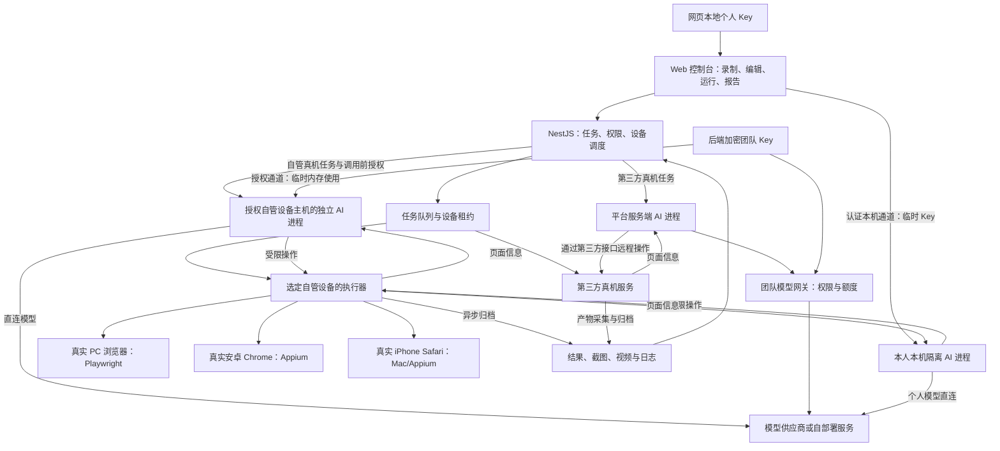

# 多端 Web 自动化测试平台方案调研

调研日期：2026-10-28。产品功能与交付范围于 2026-10-29 统一确认，详见 [功能设计与交付计划](../product/review-proposal.md)。技术判断仍需原型验证；尚未执行产品原型、设备测试或性能测试。

## 1. 已确认的需求与假设

- 用户是测试团队：可视化为主，允许脚本扩展。
- 测试对象是网页：PC 浏览器、安卓 Chrome、iOS Safari；优先支持真机。
- 需要录制、回放、编辑操作，保存视频；AI 能根据需求和页面辅助生成用例，也能探索页面。
- 同一份用例需要在测试、预发布、正式等不同 URL 上运行。
- 当前仓库只有技能和规范，没有应用实现，可沿用 Vue 3、TypeScript 的前端约定。
- 后端选型已确认采用 NestJS + TypeScript，业务数据库采用 MySQL。
- 暂按自托管团队平台设计，允许接入云真机；团队人数、设备预算和模型供应商尚未指定。
- 本次不纳入原生 App、桌面客户端自动化；它们不是已确认的测试对象。

本文用“事实”表示官方材料明确说明的能力，“判断”表示针对本项目的选型建议，“待验证”表示必须经过原型才能确认的部分。访问日期不代表文档发布日期；主分支文档可能领先正式版本。

## 2. 推荐结论

**推荐：自研 Web 控制台和用例模型，PC 执行采用 Playwright，真机执行采用 WebdriverIO + Appium，AI 作为生成和诊断层。**

判断：Playwright 的录制、等待、断言、视频与 Trace 适合高频 Web 回归；Appium 提供安卓 Chrome 和 iPhone Safari 的真机链路。通过统一用例模型、结果协议和设备调度连接二者，可以同时提供快速回归与真机验收。代价是维护两套执行适配器，以及验证二者的定位、等待和断言语义。

如果团队很小、真机执行占绝大多数，优先考虑 **WebdriverIO + Appium 统一 PC 和手机执行**，减少双引擎维护。不要为了接入 Playwright 而复制全部执行能力；是否保留双引擎由原型结果决定。

### 平台覆盖

| 目标 | 推荐链路 | 覆盖边界 |
| --- | --- | --- |
| PC Chrome / Edge / Firefox | Playwright + 对应浏览器 | 必须在目标操作系统和浏览器组合上执行，才能声称该组合通过 |
| 快速检查移动端页面 | Playwright 设备参数模拟 | 检查视口、触摸和响应式布局；不代表手机真机通过 |
| 安卓 Chrome 真机 | WebdriverIO → Appium UiAutomator2 → Chrome/Chromedriver | 需要设备调试、SDK、驱动与 Chrome 版本兼容管理 |
| iPhone Safari 真机 | WebdriverIO → Appium XCUITest → Safari | 标准自建路线采用 Mac、Xcode、WDA 签名与真机配置 |
| macOS Safari，如纳入矩阵 | WebdriverIO → Safari WebDriver | Playwright WebKit 结果不能直接标为 Safari 真机结果 |

事实：Playwright 模拟的是设备参数。[S1] Appium 的 Android 驱动支持真机、模拟器和移动 Web，XCUITest 配置支持 `browserName=safari`。[S5][S6]

事实：新版 XCUITest 也有 Windows/Linux 的有限支持，要求 iOS/tvOS 18+、RemoteXPC 以及预装或外部管理的 WDA，并不能在这些主机上用 Xcode 构建 WDA。[S7] 本项目第一版仍采用 Mac 节点，避免把这条受限路线作为默认部署前提。

## 3. 候选方案对比

以下为针对本需求的判断，不是性能排名。没有进行并发压测，也没有核实商业套餐的实时价格。

| 候选 | 需求覆盖与接入 | 成熟度与适用规模 | 成本、数据边界与迁移 | 结论 |
| --- | --- | --- | --- | --- |
| Playwright + WebdriverIO/Appium + 自研平台 | 四项功能均可设计实现；可视化录制器、步骤模型、AI 编排需自研 | 执行器已有成熟生态；平台本身需验证。PC worker 横向扩容，真机受设备槽位约束 | Apache-2.0 / MIT；开发投入较高，可自托管。JSON 用例和脚本导出降低锁定 | 首选，兼顾 Web 开发体验和真机 |
| WebdriverIO + Appium 统一执行 | PC 与真机共用较多客户端代码；录制编辑、录像汇总、AI 仍需集成 | WebDriver/Appium 生态成熟；适合真机占比较高的团队 | MIT / Apache-2.0；减少双引擎维护，浏览器等待、报告和录制体验需自行设计 | 团队较小时的重要备选 |
| Playwright 脚本 + codegen，暂缓平台 | PC 录制、代码编辑、录像、环境配置可用，不能单独完成 iPhone Safari 真机目标 | 上手快；适合验证流程及积累初始用例 | Apache-2.0；初期成本低、代码可移植，测试人员仍需读代码 | 原型基线，不作为完整交付 |
| Cypress Studio / AI + Cypress Cloud | 官方提供操作录制、AI 断言建议、自然语言生成、视频与 baseUrl；真机目标需另建链路 | Web 测试产品完整，Cloud 提供托管记录和分析 | 核心 MIT；AI 依赖 Cloud 连接，套餐额度、数据区域和条款需另核实。脚本可保留，云服务能力有迁移成本 | 现成 Web 工具参考，非本项目统一底座 |
| Selenium IDE + SIDE Runner / Grid | 有录制回放、编辑和 baseUrl；跨移动端录制、视频与 AI 仍需另建 | Selenium 生态成熟；IDE 当前 npm latest 仍为 beta，二次开发需评估 | Apache-2.0；保留 .side 和代码导出有利退出，但改成 Web 产品成本不低 | 已有 Selenium 资产时再考虑 |

事实来源：Playwright [S1–S4]；WebdriverIO/Appium [S5–S8]；Cypress [S9]；Selenium IDE [S10]。开源许可证不覆盖云服务合同、模型调用和硬件成本。

可选 AI SDK：Stagehand 提供自然语言操作、观察、提取和浏览器代理能力，MIT 许可，可本地运行或接 Browserbase。[S11] 它是 AI 能力候选，不能代替真机驱动、测试断言或可视化平台。当前主分支采用自有浏览器驱动和 Playwright 风格 API，不能假设其对象与 Playwright Page 可直接互换。

### 版本观察

本次读取 npm registry 的 `latest` 元数据：`@playwright/test` 1.64.1、`webdriverio` 10.1.0、`appium` 3.9.0、`appium-uiautomator2-driver` 8.7.3、`appium-xcuitest-driver` 12.22.2、`cypress` 16.2.0、`selenium-ide` 4.0.1-beta.14、`@browserbasehq/stagehand` 4.3.0。[S12]

这些仅是访问时的版本观察，不是已验证的兼容组合。实施时应冻结 Node、执行器、驱动、浏览器、Xcode/iOS 的版本矩阵，先通过原型再升级；不能在部署脚本中一律跟随 latest。

## 4. 产品形态与技术结构

产品的主要界面是：项目与环境、用例库、录制工作台、设备列表、运行报告、AI 助手。编辑器先采用步骤列表和参数表单，支持插入、删除、排序、重新录制片段、增加断言、复用子流程与脚本块。已确认基础条件分支和循环提供可视化配置，特殊逻辑通过脚本扩展处理。



技术栈：前端建议 Vue 3 + TypeScript + Pinia；后端确定为 NestJS + TypeScript，MySQL 保存用例版本、运行、环境、设备租约和运行状态。建议 Redis/BullMQ 管理任务；视频和 Trace 存独立文件存储，规模增长后接 S3 兼容对象存储，MySQL 保存产物元数据和存储位置。

NestJS 后端先采用模块化单体，按项目与权限、用例、环境、设备、运行任务、执行产物、AI 划分模块。通过 HTTP 接口处理管理操作，通过 WebSocket 推送设备状态、运行进度和日志；耗时任务进入队列，由执行程序领取，避免在接口请求中等待整场测试完成。

团队模型可选，无模型配置不阻塞非 AI 功能。模型 Key 按归属处理：个人 Key 仅网页本地持久化、本人本机 AI 进程临时内存使用，不提交平台后端或写入执行器磁盘。团队 Key 后端加密保存，加密密钥与数据库分别管理；团队自管真机由已绑定授权的设备主机 AI 直连模型，第三方真机由平台服务端 AI 经模型网关调用。仅向自管主机隔离 AI 进程临时提供团队凭据，不下发第三方、普通 Runner 或业务脚本；直连与网关均在调用前校验权限及预占额度。临时内存使用不使供应商长期 Key 自动过期，短期限权凭据按厂商能力验证。

个人 Key 每次启动任务时由网页读取，经已认证且加密的本机通道交接，绑定本人、任务、供应商和有效期，任务结束、取消或授权到期后清除。执行器不使用操作系统凭据库持久化个人 Key；重启后需从网页重新交接。网页存储的加密、解锁、账号隔离及删除、运行中凭据撤销和本机连接兼容性在 D06/D22 验证。不得在本机通道失败时改为经后端转发个人 Key。

NestJS 管理任务、授权、调度、团队额度及结果；本人本机、团队自管设备主机与平台服务端复用 AI 编排及模型适配代码。个人本机和团队自管主机直接将页面信息发给模型；第三方团队任务由平台服务端读取页面信息、调用模型并远程操作。个人 Key 无论设备归属都仅在本人本机使用，远端画面需先传回本人本机。报告和视频异步归档。个人任务已交接 Key 后可关闭网页，新任务或重新授权需再次交接；团队任务无需个人网页在线，但对应 AI、设备及平台授权服务必须可用。固定回放无需模型凭据，模型推理仍在供应商或自部署服务。完整决定见 [AI 编排位置](../architecture/ai-execution.md)。

已确认团队飞书、邮件、云真机和发布凭据由后端加密保存，按权限调用并记录使用及轮换；项目共享的被测网站凭据及登录状态也加密保存。个人 AI Key 仅网页本地持久化、本人本机临时使用。平台账号的密码验证材料、登录会话和测试产物按对应功能设计。

已确认平台账号支持账号密码与飞书登录，登录页提供飞书登录入口，并允许已有账号绑定飞书身份；两种方式登录同一平台账号，保持项目权限和历史记录。同时支持自助注册与管理员邀请，首次使用飞书登录可创建平台账号。平台账号与被测网站测试账号分开管理，飞书登录身份绑定与飞书文档读取、通知配置分别处理。首个管理员由部署时一次性初始化创建；绑定前验证当前身份，解绑需保留可用登录方式，支持密码重置和管理员协助恢复。

已确认团队权限支持预设角色与自定义角色。预设平台管理员、项目负责人、测试成员、只读成员；平台管理员管理全局资源，项目角色按项目分配，同一用户可在不同项目承担不同角色。保存用例、运行测试、基准管理、脚本执行、AI 确认、分享和长期保留等能力可分别授权。用例保存后按成员和环境权限直接运行，取消审批流程及额外发布步骤；版本历史、差异和执行快照保留，具体权限校验在详细设计中落实。

已确认普通成员仅能查看已加入的项目，注册不自动获得项目访问权限；被加入或邀请进入项目后默认只读，可由具有成员管理权限的人员调整预设或自定义角色。平台管理员按全局权限管理。邀请可按账号或绑定预期身份的一次性链接发起，默认 7 天有效并支持撤销。

部署支持本地单机起步：管理后台和执行程序可在同一台电脑的独立进程运行，手机连接对应设备主机。多人使用时可将 NestJS 和共享存储迁移到服务器，执行程序继续运行在被管理的真实测试电脑、安卓设备主机或 Mac 上；后续可接云真机服务。执行器通过受认证连接接收任务和回传结果，AI 服务端部署不替换目标真机。仅打开网页不会自动获得本机浏览器或手机控制能力，设备主机需要运行配套执行程序。

执行节点独立于 API：PC 浏览器运行在选定真实测试电脑的受控进程中；安卓主机连接手机；Mac 管理 iPhone。节点提供心跳、能力声明、任务取消、超时清理和产物上传。设备必须独占租约，掉线和租约过期不能导致两个任务操作同一台手机。

已确认运行支持后台与可视化两种方式，默认后台，运行前可选择切换。后台模式显示进度与结果，并按配置保存视频；手机仍会被实际操作和占用。可视化模式沿用 PC 独立测试浏览器窗口、手机平台真机画面的组合方式。运行中可看日志、当前截图并打开或收起手机实时画面；PC 启动模式运行中修改时下次生效，后台会话远程接管能力须原型验证。

已确认失败后默认自动重试 1 次，可配置次数，0 表示关闭；默认包含首次执行在内最多尝试 2 次。各次结果与产物分别保存，首次失败后成功展示为“重试后通过”。平台统一管理次数，配置按平台、项目、用例及授权单次覆盖生效；从已知前置状态重跑整个用例。有副作用且状态不明的流程停止自动重试，人工取消、权限阻止、额度耗尽和人工超时不作为普通失败自动重试；执行恢复机制在原型中验证。

已确认同时支持定时测试和发布后自动触发测试，并保留手动运行。触发配置指定用例或套件、环境、设备和数据集，各入口共用任务调度及报告并记录来源。项目显式设置时区，同计划重叠默认跳过并留记录，可改排队或并行。发布系统采用统一触发 API、查询与回调，按触发标识去重，提供 JSON/JUnit 结果；必跑组合须完成并通过，重试后通过默认附警告，可开启严格模式。

平台独立使用，手动和定时测试无需绑定代码仓库或接入 GitHub、GitLab、Jenkins。发布流程按需调用通用触发接口，特定平台的专用对接、插件及示例不作为首版必需交付。

已确认通知优先支持平台内通知、邮件和飞书；企业微信、钉钉进入扩展版。按项目配置事件、接收对象和频率：最终失败在重试结束后通知，等待人工立即通知，普通成功默认进汇总；另支持设备异常、额度和需求变化通知。

初期只为实际支持的平台声明能力。例如 `web.navigate`、`web.fill`、`web.click`、`web.expectText` 可作为共同子集；软键盘、浏览器权限弹窗和特殊手势通过平台专用步骤表达，不伪装为通用能力。

### 代码组织与维护架构

建议采用 **pnpm workspace Monorepo + NestJS 模块化单体 + 独立 Runner**。这是代码组织和部署建议，目前尚未创建应用工程。

```text
riqvo/
├── apps/
│   ├── web/                    # Vue 管理台、步骤编辑器、录制界面
│   ├── server/                    # NestJS 后端，统一管理业务与调度
│   └── runner/                 # Node.js/TypeScript 执行程序
├── packages/
│   ├── contracts/              # API、任务、用例步骤、结果的 schema 与类型
│   ├── ai-agent/               # 本人本机、自管设备主机及平台服务端复用 AI 编排
│   ├── test-engine/            # 步骤执行流程、状态、断言和驱动接口
│   ├── driver-playwright/      # PC 浏览器操作、截图、视频、Trace
│   └── driver-appium/          # 安卓/iPhone 浏览器与设备操作、录屏
├── deploy/                     # 本地依赖和不同执行节点的部署配置
└── docs/                       # 需求、架构决策、调研及使用文档
```

Monorepo 表示代码在同一个仓库中维护，不意味着所有程序必须部署到同一台服务器。API 初期是一个 NestJS 应用；Runner 是独立进程，按节点能力运行在测试电脑、安卓设备主机或 Mac 上。Runner 代码可以共用，依赖安装和设备配置按节点分别管理。

后端按业务拆成 Auth、Projects、Cases、Environments、Devices、Runs、Artifacts、AI 等模块。模块内由 Controller 接收和校验请求，Service 处理业务，Repository 封装数据访问。模块之间使用明确导出的服务接口，避免跨模块直接修改数据表。第一版不再拆出复杂的领域框架或多个业务微服务。

依赖边界：

- Web 通过 API 与 WebSocket 管理任务，只共享 contracts，不直接访问数据库或设备驱动；个人 Key 通过独立的认证加密本机通道临时交给本人执行器中的隔离 AI 进程。
- API 保存用例版本与任务状态、调度设备、管理权限；Runner 领取带版本号的任务并回传结果，不直接访问业务数据库。
- test-engine 定义驱动接口；具体驱动实现接口，Runner 负责装配，通用引擎不依赖某个驱动实现。
- ai-agent 与设备驱动解耦；个人模式在本人本机临时使用网页交接的 Key，团队模式按设备归属选择自管主机直连或平台服务端经网关调用。自管主机须通过绑定授权才能接收临时凭据，第三方、普通 Runner 和业务脚本不获取团队模型 Key；两条团队路径共用调用前额度控制，环境权限在实际操作边界校验。
- 人工录制、编辑器和 AI 都产生同一份步骤 schema。AI 的建议进入草稿和试跑流程，保存时创建新版本，保留已有版本和运行快照。
- 浏览器和手机录制采集分别实现，转换为统一步骤；共享格式不代表各平台录制能力完全相同。

维护方式：统一 TypeScript、格式和 lint 配置；版本化 contracts 和步骤 schema；数据库变更通过 migration 管理；每次运行固定用例版本、数据集与环境配置版本，并保存脱敏执行信息。CI 验证类型、构建、关键业务和驱动契约；设备集成测试单独执行，并分别报告 PC、安卓、iPhone 的结果。与执行器相关的发布必须经过相应平台验收，普通单元测试不能代替真机验证。

已确认公共流程采用固定引用版本、确认后升级的方式。新版本保存后提示受影响用例，用户可以选择或批量确认升级；未升级用例继续使用原版本，已经开始的运行与历史报告不随升级改变。

初期使用 pnpm workspace 的包脚本管理构建和检查即可，按实际构建耗时再决定是否引入额外构建编排工具。规模增长时优先增加 Runner 和设备槽位；只有出现清晰的性能或团队边界，再考虑拆分 AI、产物处理等独立服务。

## 5. 操作录制、编辑和回放

### 用例是结构化步骤

不要把视频或完整生成代码当成可视化编辑的唯一数据源。持久化版本化 JSON 模型：步骤 ID、操作类型、页面/iframe 上下文、逻辑元素、参数引用、等待条件、断言、失败处理和来源。

示意格式如下，仅表示产品设计，不是现成 SDK：

```yaml
case: 搜索商品
steps:
  - action: navigate
    target: shop
    route: search
  - action: fill
    element: search.keyword
    valueFrom: data.keyword
  - action: click
    element: search.submit
  - action: expectText
    element: search.results
    expectedFrom: data.expectedProduct
```

逻辑元素映射保存 test id、可访问角色/名称、CSS 等定位候选及适用布局；不同执行器各自解析。自有页面优先维护稳定 test id，结合语义定位。匹配到多个元素或定位发生歧义时应停止并报告，不能自动选择第一个元素来“通过”测试。

### 录制技术路线

已确认采用组合模式：PC 在执行程序启动的独立受控浏览器窗口中操作，平台同步显示步骤；手机通过平台内的真机画面操作。

- **PC**：先用 Playwright codegen 验证定位和录制行为，再开发受控浏览器的事件采集与步骤归一化。官方 codegen 是命令行/Inspector 工作流；`page.pause()` 也会打开独立 Inspector。没有依据把其内部 Recorder 当作稳定可嵌入 SDK。[S2]
- **Web 工作台**：PC 模式展示录制控制与实时步骤，用户操作独立浏览器窗口；手机模式同时展示远控真机画面与步骤。采集用户操作、页面导航、弹窗和元素上下文，再生成步骤。远控画面、保存的视频、可回放步骤是三种不同产物。
- **手机**：第一版明确支持从平台设备面板发起的受控操作，并记录对应 Web/设备命令。直接用手操作任意手机、后台完整捕获并还原所有语义，需要额外采集方案，不能声称 Appium 自动提供。
- 手机网页的 DOM 事件采集需要验证导航后重新注入、跨域 iframe、原生键盘和浏览器 UI 的边界。难以可靠识别的手势先保存为显式平台步骤，再由用户确认。
- 回放以元素状态和业务断言等待，减少固定 sleep；输入事件合并为填值动作，保留真正必要的按键、滚动及导航。
- 每个用例必须有成功判定。“所有点击都没报错”不足以判为业务测试通过。

Playwright 脚本和 WebdriverIO 脚本可以作为导出产物。脚本扩展块作为独立、版本化节点保存；不要承诺任意脚本都能无损导回图形编辑器。受支持 JSON 模型才是平台内的权威来源。

## 6. 视频与报告

事实：Playwright 支持测试录像，关闭 browser context 后完成视频保存；视频可按失败保留。[S3] Appium 的 iOS 驱动提供设备录像命令，相关路径需要 ffmpeg，官方文档说明该录像不含音频；安卓也有设备录屏能力。[S5][S6]

建议每次运行关联用例版本、环境、设备/浏览器版本、数据集、逐步结果、时间戳、截图、视频和日志。PC 附带 Playwright Trace；真机产物通过适配器汇总，不宣称可提供完全相同的 Trace。

视频应支持录制期间和回放期间按需保存；步骤时间轴与视频对齐。长录屏分段、异常终止时的文件完整性、编码和浏览器播放兼容性都需要验证。测试失败与录屏失败应分别记录。

已确认测试回放录像默认全部保留，覆盖成功、失败及各次重试，允许配置为仅保留失败相关录像或关闭录像。该默认值描述哪些运行的视频需要保留，保存时长按保留期限配置执行。

已确认视频、执行截图和 Trace 默认保留 30 天，报告与执行结果默认保留 180 天；关联产物到期清理后，报告显示“已清理”。保留期限可按项目调整，也可选择永久保留。重要运行可标记“长期保留”，其报告及尚存的关联产物免于自动清理。从运行或录制结束起算期限，策略修改默认影响新记录，已有记录可批量调整；项目负责人管理长期保留并可授权。清理时检查引用，在用截图基准随基准版本管理。

已确认报告支持登录查看与临时外部分享：平台内、飞书和邮件中的普通报告链接默认要求登录及对应项目的查看权限；外部分享默认 7 天有效并启用密码，可配置且可随时撤销。报告及产物统一校验分享有效性与范围，默认只读摘要和勾选证据；分享不延长产物期限，项目负责人管理分享并可授权。支持 PDF、Markdown、HTML 离线包、批注、负责人及缺陷链接；录制工作台也默认录屏，首版不录音。

已确认支持截图对比，作为可选断言。同一平台、浏览器和视口下，不同环境默认共享基准，也允许配置环境专用基准；环境专用配置优先，未配置时使用匹配的共享基准。支持动态区域忽略和差异容忍，差异像素比例默认 0.1% 并可覆盖；报告保存基准图、当前图、差异图及基准版本。基准由有管理权限的成员确认，更新后保留历史结果。首版支持当前视口和元素区域，整页能力及容忍参数的适用性需实际验证。

## 7. 跨 URL、跨设备复用

运行实例由 **用例版本 × 环境 × 浏览器/设备 × 数据集** 决定。

已确认项目环境可自定义，支持开发、测试、预发布、正式及其他环境；环境名称和数量不固定为两类。每个环境分别配置 AI 操作权限，跨环境运行采用目标环境的规则，环境名称本身不决定执行权限。

环境保存命名站点、origin、base path、账号引用、数据准备与清理方式；用例保存逻辑站点和路由。示意：`shop` 在测试环境指向 `https://test.example.com`，正式环境指向 `https://www.example.com`，用例不写死这两个域名。

需要处理：

- URL 的 origin、base path、查询参数和 hash 路由。明确路径拼接规则，避免前导 `/` 丢失部署子路径。
- 多站点和 SSO 使用命名目标映射；导航、URL 断言及必要的 API 目标都要参数化，不做全局字符串替换。
- 凭据和会话按环境隔离；不能把测试环境 Cookie 原样搬到正式环境。
- 已确认普通业务用例优先复用被测网站的有效登录状态，失效后重新登录；允许按用例选择重新登录，登录功能测试从未登录状态开始。被测网站账号与测试平台账号分开管理，登录状态按环境、账号和设备分别维护；各驱动的保存和恢复能力需验证。
- 桌面和移动布局共用业务流程，必要时使用明确的布局分支或子流程，例如移动端先打开菜单。
- 各环境选择对应的数据集和测试账号，AI 操作和固定回放均受目标环境执行权限及已声明业务动作规则约束。新环境默认选择只读模板，管理员可调整；用例保存后按权限直接运行，不设置环境版本审核。

跨环境复用通常较容易；跨端能否完全复用取决于页面结构和交互差异。应在产品中展示兼容平台及平台专用步骤。

## 8. AI 的三个层次

### 需求驱动生成：优先建设

已确认采用先确认场景的流程：需求文档 → 场景、前置条件和验收标准 → 用户勾选、修改并确认测试范围 → 页面探索（DOM/可访问结构/必要截图）→ 结构化步骤与断言 → 目标设备试跑 → 可编辑草稿 → 操作者直接保存用例版本或试跑。访问页面和试跑发生在用户确认测试范围之后，无独立用例审批环节。

已确认支持直接输入或粘贴文字、Markdown、Word、PDF 和飞书文档链接；首版支持飞书、Markdown、直接输入及常见表格和可访问图片，Word/PDF/OCR 后续接入。飞书由企业应用访问明确授权的文档，默认 15 分钟检查更新并可配置，展示差异和受影响用例，由用户决定是否生成修改草稿；操作者保存修改时创建新版本。Markdown 本地上传新版本后也展示差异，当前不包含 Git 仓库关联。场景每批展示 10 条并可增删和分页，保留来源与用例版本关联，具体文档及模型能力通过原型验证。

需求没有定义的业务规则应标为待确认，不让 AI 根据页面现状反推“正确答案”。保留需求段落到用例、断言的映射，并记录生成时的平台和页面证据。已保存的稳定用例默认按固定步骤执行，减少重复模型调用和运行差异。

模型服务同时支持平台统一配置与用户个人配置；团队模型为可选，平台支持无模型、仅个人、仅团队及两者都有。团队模型已配置且获授权时可作为默认，AI 任务明确所选模型和计费归属，不自动切换。团队 Key 后端加密保存；个人 Key 仅网页本地持久化，当前任务交给本人本机临时内存使用，结束清除。采用通用接口与厂商适配器，支持自定义地址、模型名及自部署服务；首批验证 OpenAI、Anthropic、Gemini、DeepSeek、通义千问等候选，其他国内外服务逐步扩展，不将候选清单当作已兼容结果。固定步骤回放和定时执行不要求模型；个人 AI 自动任务缺少有效交接时不能启动模型调用，不能假定存在团队模型兜底。

已确认团队模型由管理员配置、成员按权限使用，按项目和责任人统计月度 Token 用量及预估费用，80% 提醒、达到适用上限暂停新调用并保留进度。额度补充后重新调度恢复，现场最多保留项目人工等待时长，释放后重新验证前置状态。并发计量机制在详细设计中落实；预估用量和费用与供应商实际结算分别标识。

事实：Playwright Test Agents 已提供 planner、generator、healer，planner 可接收 PRD，generator 会在页面上验证定位和断言。[S4] 这些是开发工具中的代理定义与工具链，接入产品仍需要任务编排、权限、审查和本项目步骤模型的转换。

### AI 辅助维护

分析失败截图、DOM、日志及执行轨迹，提出定位或等待条件的修改草稿。已确认草稿试跑失败后默认自动修订 1 轮，可配置且独立于普通重试次数；已有用例生成修复草稿后，由操作者直接编辑、保存新版本或试跑。保存旧版本、差异和再验证结果，不以删除断言、放宽预期或跳过测试掩盖业务失败；官方 healer 可能输出 skipped，因此平台必须区分 passed、failed、skipped 和未完成。[S4]

### 自主探索：独立模式

用户指定站点、目标、账号、范围、最大步数与时间/模型预算。已确认默认有效执行上限为 20 分钟或 100 个动作，先到即止，可配置。AI 发现路径和可疑问题并保存重现步骤，转成可编辑用例草稿；达到上限只报告实际探索范围，不宣称已覆盖全部需求。

已确认自主探索遇到需要人工处理的阻塞时，默认暂停并保留现场，进入“等待人工”状态；人工接管处理并归还控制后，AI 再继续。已确认人工等待默认 10 分钟，可按项目调整，适用于验证码、需要人工确认等等待场景；等待期间保留页面现场并继续占用设备，通过已配置的通知渠道提醒处理。超时后结束当前 AI 任务并标记“等待人工超时”，释放设备，保留已产生的步骤、截图和视频，后续可重新运行。

已确认接管期间暂停 AI 操作和模型循环，有效执行时间暂停、实际设备占用另记；恢复时重新读取页面状态并保留接管记录。等待人工立即通过配置渠道通知，超时不按普通失败自动重试。

已确认 AI 操作权限按具体环境配置，适用于预发布及其他自定义环境。浏览与查询、新增、修改、删除、支付、发送短信或邮件等业务动作分别可设为允许、需人工确认或禁止，并可限定站点、页面或业务流程；由具备相应管理权限的项目成员维护。跨环境采用目标环境规则，个人与团队模型遵循相同规则。新环境提供只读、常规测试和自定义模板，默认选择只读，管理员可调整。

已确认执行规则：结合任务发起人权限、环境规则和任务授权范围，跨环境重新校验，确认记录绑定环境及动作，单次确认不能覆盖禁止规则。个人与团队模型均由平台和执行端在实际操作前校验，不能仅依靠模型提示遵守权限。

业务动作识别和只读约束需通过页面或流程规则、被测账号权限验证，不能仅凭按钮文案或 HTTP 方法保证。未知动作需声明或人工确认，规则覆盖生成、试跑、修复、探索及固定回放；固定回放不为每步额外调用 AI。权限收紧在下一动作前生效，放宽须重新授权；记录实际策略与结果，阻塞或等待不报告为通过。执行机制仍需原型验证。

PC 可接 Playwright 工具；真机需要为同样的受限工具协议实现 Appium 适配。Stagehand 或 Playwright MCP 可用于验证浏览器探索，但不能默认具备 iOS Safari 真机执行能力。[S4][S11]

页面及文档内容作为测试数据处理；执行权限由平台控制。模型看到的页面内容和日志需按项目规则处理，凭据通过独立引用注入。各环境的业务操作和脚本块权限应明确绑定环境及用户角色。

## 9. 真机部署与成本

已确认采用混合接入：自有设备与云真机均需支持，优先接入自有电脑和手机，后续扩展云真机。首批目标为 PC Chrome/Edge、安卓 Chrome 真机及 iPhone Safari 真机；首个云服务候选 BrowserStack、备选 Sauce Labs。具体机型、版本、套餐及接入可行性通过原型和供应商能力验证后确定。

| 方式 | 适用条件 | 主要投入与待核实项 |
| --- | --- | --- |
| 自建设备池 | 有 Mac 和手机、内网站点较多、数据需留在内部 | 硬件、供电与连接稳定性、WDA 签名、系统升级、设备健康和运维 |
| 云真机服务 | 需要较多机型/系统版本，或希望先验证可行性 | 并发槽位、设备使用量、视频保留、网络隧道和供应商条款；先确认所购产品支持移动网页自动化 |
| 混合模式 | 核心机型高频回归、少见机型周期性验证 | 自建与云统一能力匹配、产物接口和排队策略 |

WebdriverIO 官方明确支持对接 BrowserStack、Sauce Labs 等云服务。[S8] 本次未核实供应商具体机型库存、报价、数据地区或套餐保证。云服务应作为可替换的 Runner Provider，不把供应商能力直接写入业务用例。

总成本由开发维护、浏览器/设备运行时长、并发槽位、视频存储与传输、模型输入输出共同决定。不能只比较开源许可证价格。

容量可以先按 `每日运行次数 × 平均占用分钟数 / 设备可用分钟数` 估算基础槽位，再增加排队峰值、初始化和重试余量。所有耗时参数由原型实测。正式运行尽量复用已保存版本的步骤，仅在生成、探索和诊断时调用 AI。

## 10. 原型与分阶段交付

以下分期已于 2026-10-29 随 [功能设计与交付计划](../product/review-proposal.md) 获得统一确认：首版团队内测包含三端测试和基础 AI，扩展能力随后交付。确认的是交付范围与顺序，尚未执行原型或承诺日历工期。

### 第一阶段：验证完整技术链路

准备一个有测试数据的目标网站、两套环境、一台 PC、一台安卓真机、一台 iPhone 和可用的 iOS 执行节点；也可用云真机代替本地硬件。

选择约 6–10 条代表性用例，包含登录、表单校验、查询、移动菜单；按目标网站实际情况加入 iframe、弹窗、文件上传与软键盘场景。

验收目标，尚未执行：

1. PC 与手机受控会话均可记录操作，编辑一个步骤后重新运行。
2. 同一用例切换两套 URL，凭据及数据不串环境。
3. 各端生成可播放视频，报告能定位失败步骤；执行异常时正确释放设备。
4. 用已知正确结果验证通过，再故意制造错误结果，确认断言失败。
5. 核心用例重复执行，记录首次通过率、重试通过率、失败原因与设备掉线，不能把重试成功掩盖为首次成功。可先以每端 20 次为观察样本，不把它当成可靠性证明。
6. 输入一份短需求，AI 生成带断言的用例，并在至少安卓和 iPhone 的实际页面验证定位；记录人工修改量与模型费用。

该阶段优先判断手机录制可行性、iOS 节点稳定性以及双引擎是否值得保留。失败时先缩小录制交互范围，或改用 WebdriverIO 统一执行；不能以模拟器通过替代真机验收。

### 第二阶段：可供测试团队内测的完整首版

按三个里程碑交付：先完成项目与身份、环境、自有设备、三端录制回放、编辑器、数据、断言与基础脚本；再完成报告导出分享、保留策略、定时与发布触发及优先通知渠道；最后完成飞书/Markdown/文字生成用例、基础探索、修复草稿、模型配置与额度、AI 权限及人工接管。完成三个里程碑后才算满足已确认的首版范围，PC、安卓、iPhone 和基础 AI 均包含在内。

### 第三阶段：能力扩展

补齐 Word/PDF/OCR、更多国内外模型、首个云真机服务、更多浏览器与机型、复杂交互、移动端文件和网络检查、脚本导出、缺陷系统集成及企业微信/钉钉。总功能范围和已确认的优先级保持，接入能力逐项验证。

### 第四阶段：规模化优化

依据实际使用量优化设备池调度、并发稳定性、模型与存储成本、探索覆盖分析和跨版本兼容，按数据决定是否进一步拆分服务。

尚无团队规模、设备条件和目标站点，因此暂不承诺日历工期。录制远控、iOS 真机配置、跨引擎定位兼容是排期中的主要不确定项；应以第一阶段的结果给出工时估算。

## 11. 证据与来源

以下官方文档及源码均在 2026-10-28 访问；通过官方 GitHub 仓库读取，npm 元数据从官方 registry 获取。没有进行付费产品实测、设备实测或兼容组合认证。

- **S1**：[Playwright 能力与许可](https://github.com/microsoft/playwright)、[设备模拟](https://github.com/microsoft/playwright/blob/main/docs/src/emulation.md)。
- **S2**：[录制操作与断言](https://github.com/microsoft/playwright/blob/main/docs/src/codegen-intro.md)、[codegen 与自定义 setup](https://github.com/microsoft/playwright/blob/main/docs/src/codegen.md)。
- **S3**：[视频](https://github.com/microsoft/playwright/blob/main/docs/src/videos.md)、[baseURL、认证与产物配置](https://github.com/microsoft/playwright/blob/main/docs/src/test-use-options-js.md)。
- **S4**：[Playwright Test Agents](https://github.com/microsoft/playwright/blob/main/docs/src/test-agents-js.md)、[Playwright MCP](https://github.com/microsoft/playwright-mcp)。
- **S5**：[Appium UiAutomator2：前提、移动 Web、真机及录屏](https://github.com/appium/appium-uiautomator2-driver)。
- **S6**：[XCUITest capabilities / Safari](https://github.com/appium/appium-xcuitest-driver/blob/master/docs/reference/capabilities.md)、[系统要求](https://github.com/appium/appium-xcuitest-driver/blob/master/docs/getting-started/system-requirements.md)、[真机配置](https://github.com/appium/appium-xcuitest-driver/blob/master/docs/getting-started/device-setup.md)、[录像命令](https://github.com/appium/appium-xcuitest-driver/blob/master/docs/reference/commands.md)。
- **S7**：[XCUITest 非 macOS 主机的限制](https://github.com/appium/appium-xcuitest-driver/blob/master/docs/guides/non-macos-hosts.md)。
- **S8**：[WebdriverIO：协议、Appium、云服务、许可](https://github.com/webdriverio/webdriverio)、[Appium 与许可](https://github.com/appium/appium)。
- **S9**：[Cypress Studio AI](https://github.com/cypress-io/cypress-documentation/blob/main/docs/app/ai/cypress-studio.mdx)、[AI 生成与云端要求](https://github.com/cypress-io/cypress-documentation/blob/main/docs/app/ai/ai-test-generation.mdx)、[架构限制](https://github.com/cypress-io/cypress-documentation/blob/main/docs/app/core-concepts/trade-offs.mdx)、[配置](https://github.com/cypress-io/cypress-documentation/blob/main/docs/app/configure/configuration.mdx)、[核心许可](https://github.com/cypress-io/cypress/blob/develop/LICENSE)。
- **S10**：[Selenium IDE：录制、回放、编辑与导出](https://github.com/SeleniumHQ/selenium-ide)、[SIDE Runner 与 baseUrl](https://github.com/SeleniumHQ/selenium-ide/blob/trunk/packages/side-runner/README.md)。
- **S11**：[Stagehand 能力、架构、Browserbase 接入和许可](https://github.com/browserbase/stagehand)。
- **S12**：[Playwright npm 元数据](https://registry.npmjs.org/@playwright/test/latest)、[WebdriverIO](https://registry.npmjs.org/webdriverio/latest)、[Appium](https://registry.npmjs.org/appium/latest)、[UiAutomator2](https://registry.npmjs.org/appium-uiautomator2-driver/latest)、[XCUITest](https://registry.npmjs.org/appium-xcuitest-driver/latest)、[Cypress](https://registry.npmjs.org/cypress/latest)、[Selenium IDE](https://registry.npmjs.org/selenium-ide/latest)、[Stagehand](https://registry.npmjs.org/@browserbasehq/stagehand/latest)。
